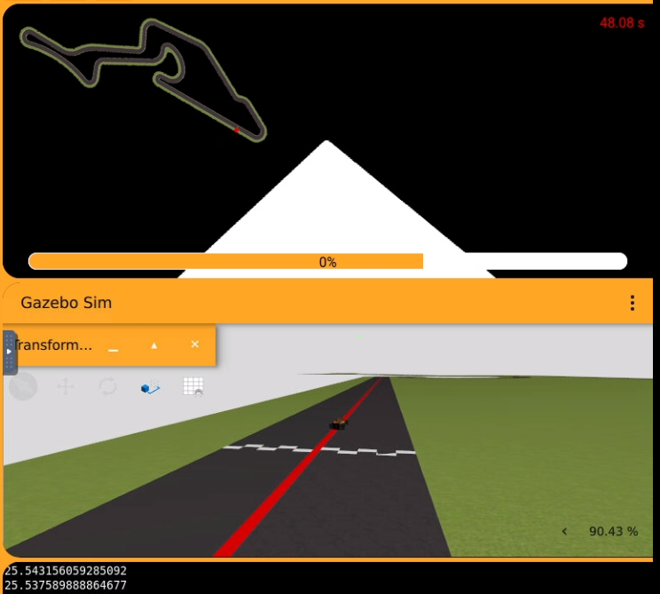
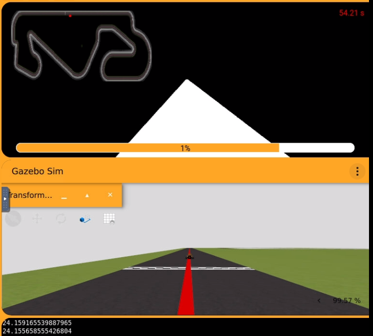
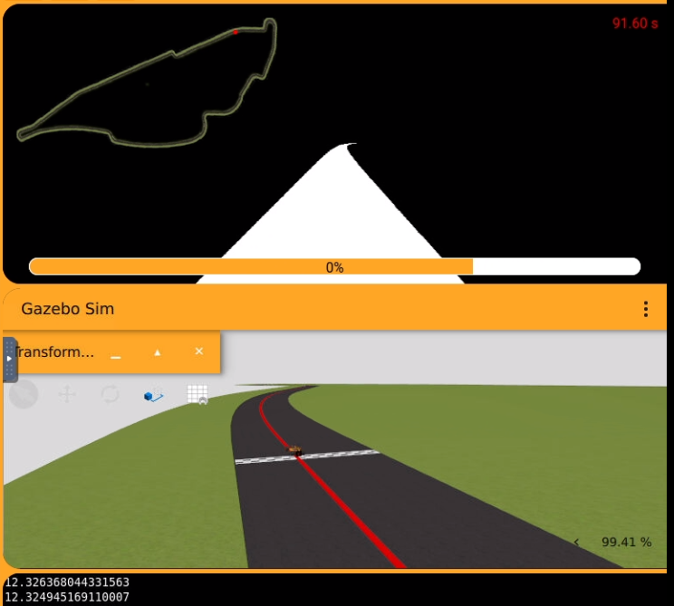
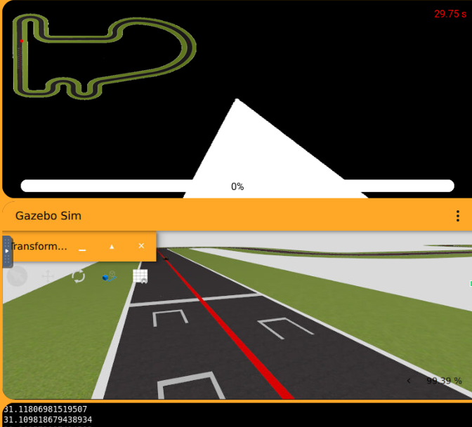

# Práctica 2 – Sigue-líneas

## Resumen

Se han desarrollado **dos controladores** para que el coche siga la línea roja del circuito:

| Controlador | Tipo | Velocidad lineal | Tiempo (Simple Circuit) | Error medio |
|---|---|---|---|---|
| **Rápido (elegido)** | PID | `18 - abs(err) * 0.18` | **32.59 s** | 26.50 |
| Seguro | PD | 4.5 (constante) | 95.85 s | **13.05** |

El controlador elegido es el **PID rápido**: completa todos los circuitos sin perder la línea en ningún momento. Los giros no son tan suaves como con el controlador de baja velocidad, pero se ha decidido premiar la velocidad.

<video controls preload="metadata" playsinline style="width: 100%;" aria-label="Vídeo: controlador PID en Simple Circuit">
  <source src="/Robotica-Movil-Practicas/vid/ControladorPID.mp4" type="video/mp4" />
  <a href="/Robotica-Movil-Practicas/vid/ControladorPID.mp4">Ver vídeo: controlador PID en Simple Circuit</a>
</video>

---

## Resultados del controlador elegido (PID)

Todos los circuitos se han recorrido con **el mismo controlador**, sin cambiar ningún parámetro:

| Circuito | Tiempo | Error medio |
|---|---|---|
| Simple Circuit | 32.59 s | 26.50 |
| Montreal | 91.60 s | 12.27 |
| Montmeló | 54.21 s | 24.06 |
| Nürburgring | 48.08 s | 25.00 |
| **Media total** | — | **21.96** |

Se han completado todos los circuitos sin problema. El circuito con el error medio más alto es el Simple Circuit (26.50).

### Velocidad lineal

Para ajustar al máximo la velocidad, una de las pruebas que realicé fue la siguiente: 1 variación en la velocidad, que dió los siguientes resultados:

| V inicial | Tiempo | Error medio |
|---|---|---|
| **18** | **32.59 s** | **26.50** |
| 20 | 29.75 s | 30.95 |

Con V = 20 se baja de los 30 s, pero el error medio considero que aumenta más de lo que disminuye el tiempo, por lo que finalmente decidí quedarme con la V inicial de 18.

---

## Controlador alternativo: PD "seguro"

Se ha hecho un segundo controlador más conservador con el objetivo de bajar el error medio.

- **Sin parte integral:** tras varias pruebas, funcionaba mejor sin ella.
- **Velocidad lineal constante de 4.5.**
- Sigue la línea muy bien, no la pierde en ningún momento, no oscila y su trayectoria es suave y tranquila.

**Resultado en Simple Circuit:** error medio de **13.05** con un tiempo de **95.85 s**.

<video controls preload="metadata" playsinline style="width: 100%;" aria-label="Vídeo: controlador PD en Simple Circuit">
  <source src="/Robotica-Movil-Practicas/vid/ControladorPdLento.mp4" type="video/mp4" />
  <a href="/Robotica-Movil-Practicas/vid/ControladorPdLento.mp4">Ver vídeo: controlador PD en Simple Circuit</a>
</video>

---

## Recuperación al perder la línea

Si no se detecta ningún píxel rojo en la máscara:

1. Se detiene el coche.
2. Se gira hacia el último sentido en el que había girado.
3. Si es la primera iteración y todavía no ha girado, gira siempre hacia la **izquierda**.

<video controls preload="metadata" playsinline style="width: 100%;" aria-label="Vídeo: recuperación de la línea">
  <source src="/Robotica-Movil-Practicas/vid/RecLineaHolonomica.mp4" type="video/mp4" />
  <a href="/Robotica-Movil-Practicas/vid/RecLineaHolonomica.mp4">Ver vídeo: recuperación de la línea</a>
</video>

---

## Dinámica Ackermann

Se ha seguido el mismo procedimiento que en el modo holonómico, salvo en estos puntos:

- **Pérdida de la línea:** además de dar velocidad angular (`SetW`), hay que añadir algo de velocidad lineal, porque con Ackermann el coche no puede girar sobre sí mismo (cosa que sí hace bien el modo holonómico).
- **Más velocidad angular:** se ha subido `W`, ya que en Ackermann el coche gira más lento y necesita más espacio.

<video controls preload="metadata" playsinline style="width: 100%;" aria-label="Vídeo: recuperación de la línea Ackerman">
  <source src="/Robotica-Movil-Practicas/vid/RecLineaAckerman.mp4" type="video/mp4" />
  <a href="/Robotica-Movil-Practicas/vid/RecLineaAckerman.mp4">Ver vídeo: recuperación de la línea Ackerman</a>
</video>

---

## Conclusión y reflexión

Se han generado dos controladores: un **PID rápido**, que es el elegido, y un **PD lento** que sacrifica tiempo a cambio de un error mucho menor. 

El controlador rápido, funcionaba también sin la parte integradora, pero, tras varias iteraciones, conseguí que la parte integradora ayudase a reducir el Tiempo y el Error Medio. La principal aplicación a la que le he dado uso ha sido para reducir el error en las curvas, sobre todo en las curvas largas. Cuando el Error disminuía a 10, el sumatorio del error (parte integral), se reducía a cero, para no afectar a las siguientes curvas.

También, para el calcular el Centroide de la línea, he realizado una máscara, o un "recorte" de la imagen vertical, de 0 a 480 por 75 -> 300, para eliminar aquellas filas que no son importantes (Cielo), y también para calcular el centroide más delante, recortando la parte más cerca del coche (0 -> 75), para intentar "adelantar" movimientos.

Salvo estos dos cambios, las ganancias del controlador PID (Kp, Kd y Ki) se ajustaron mediante prueba y error, observando el comportamiento del coche (si oscilaba, si se iba en curvas pronunciadas...), el tiempo recorrido y el Error Medio

El controlador de baja velocidad se incluye para hacer la siguiente reflexión: cuanto más se baja la velocidad lineal, más fácil resulta ajustar el controlador y más se puede reducir el error medio. Es decir, hay un compromiso claro entre **velocidad** y **precisión**, y en esta práctica se ha optado por la velocidad.