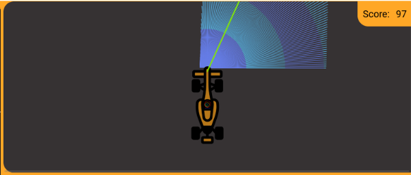
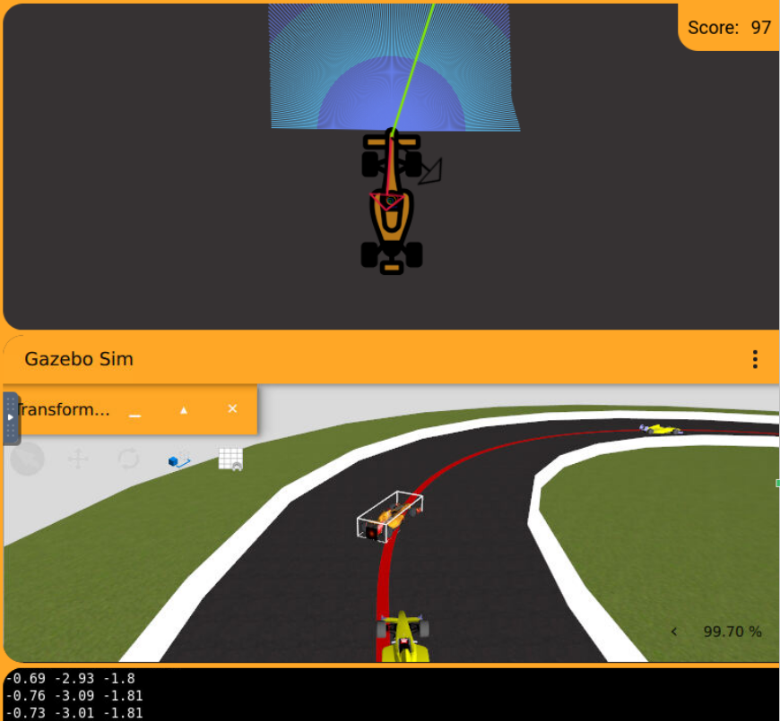

## Introducción

El objetivo era que el coche diera la vuelta al circuito pasando por los waypoints y esquivando obstáculos con el algoritmo VFF: el waypoint atrae, los obstáculos repelen y el coche sigue la suma. La versión final completa la vuelta en alrededor de 1 minuto. Al final de la memoria se presentará el vídeo.

## Paso 1: el vector hacia el target

Primero calculé la distancia entre el target y el coche en absolutas y la pasé a coordenadas relativas del coche girándola con `-yaw`. Así obtuve la flecha verde apuntando al waypoint.



Al principio usaba el vector completo, cuyo tamaño es la distancia al waypoint. El problema era que, con el waypoint lejos, el atractivo dominaba y el coche apenas esquivaba, mientras que con el waypoint cerca ocurría lo contrario. Probé a limitarlo a 4 m, pero había waypoints junto a obstáculos a los que no llegaba. Finalmente opté por el vector unitario, ya que solo interesa la dirección.

Para pasar al siguiente waypoint lo marco cuando estoy a menos de 1,5 m. Con 0,5 m el coche pasaba junto al waypoint sin llegar a marcarlo y empezaba a oscilar.

## Paso 2: el vector de los obstáculos

Por cada rayo del láser que detecta algo a menos de 5 m creo una fuerza en sentido contrario al obstáculo, de tamaño 1/d², y las sumo. El rayo 90 es el de delante, así que el ángulo de cada uno es `i - 90`. Como quería darle más importancia a los rayos del láser frontales, a los rayos entre 50 y 130 les sumé un peso 4, frente a los laterales con peso 1.

```python
ox, oy = 0, 0
for i, medidas in enumerate(data):
    if 0 < medidas < 5:
        peso = 4 if 50 < i < 130 else 1
        ang_rayo = math.radians(i - 90)
        fuerza = -peso / (medidas * medidas)
        ox += fuerza * math.cos(ang_rayo)
        oy += fuerza * math.sin(ang_rayo)
```

## Paso 3: el coche oscilaba

Al sumar `alfa * atractivo + beta * repulsivo`, el coche oscilaba de izquierda a derecha y la resultante apuntaba hacia atrás. Al imprimir los valores comprobé que la X de la resultante era negativa y que el ángulo de giro saltaba de -1,8 a +1,9 radianes entre iteraciones.



El motivo es que el láser solo ve por delante, así que el repulsivo siempre empuja hacia atrás, y con paredes cerca gana al atractivo. Con la resultante hacia atrás, en cuanto la Y cambia de signo el giro salta de un extremo al otro.

Bajar `beta` corregía el problema en esa zona, pero no con obstáculos más cercanos. Limitar el láser a los rayos frontales tampoco lo resolvía, porque son precisamente los que más empujan hacia atrás.

## Paso 4: la Y del repulsivo para girar, la X para frenar

La componente hacia atrás del repulsivo no aporta información sobre hacia dónde girar; lo que permite esquivar es el empuje lateral. Por eso separé ambas componentes: `oy` entra en la resultante y decide el giro, y `ox` no entra en ella, sino que la uso para frenar.

```python
resultx = alfa * ax
resulty = alfa * ay + beta * oy
velocidad = max(12 + 0.1 * ox, 3.5)
```

Con esto la resultante ya no puede apuntar hacia atrás y desaparecieron los giros bruscos. 
En el frenado cometí un error inicial: escribí `10 - 0.1 * ox`, y como `ox` es negativo, el coche aceleraba al acercarse a los obstáculos. Con `+ 0.1 * ox` el frenado funcionó correctamente.


## Paso 5: ir más rápido sin chocarme

Al aumentar la velocidad, el coche chocaba por falta de tiempo para girar, y en algunas rectas oscilaba: el mismo giro a 12 m/s desplaza el coche mucho más que a 4 m/s. Lo resolví haciendo que la ganancia de giro sea inversamente proporcional a la velocidad:

```python
HAL.setW(angulo * Kp / velocidad)
```

Con `Kp = 3`, a 3 m/s gira como antes y a 12 m/s gira cuatro veces menos. Así pude subir la velocidad máxima a 12 m/s. Para el ajuste, modifiqué un único parámetro cada vez y cronometré la vuelta.


## Resultado y lo que mejoraría

El coche hace la vuelta en aproximadamente 1 minuto, esquiva los obstáculos, frena ante ellos y aprovecha la velocidad máxima en las rectas.

<video controls preload="metadata" playsinline style="width: 100%;" aria-label="Vídeo: VFF">
  <source src="/Robotica-Movil-Practicas/vid/Video_VFFPR3.mp4" type="video/mp4" />
  <a href="/Robotica-Movil-Practicas/vid/Video_VFFPR3.mp4">Ver vídeo: VFF</a>
</video>


## Conclusiones

Las decisiones que más mejoraron el comportamiento fueron tres: utilizar únicamente la dirección del vector atractivo, para que el equilibrio entre fuerzas no dependa de la distancia al waypoint; separar las componentes del repulsivo, empleando la lateral para el giro y la longitudinal para el frenado, lo que eliminó las oscilaciones causadas por una resultante que apuntaba hacia atrás; y hacer la ganancia de giro inversamente proporcional a la velocidad, lo que permite circular rápido sin oscilar. 

VFF tiene una limitación conocida: el problema de los mínimos locales. Ocurre cuando las fuerzas atractivas y repulsivas se compensan y la resultante se anula, de modo que el robot queda atrapado sin saber hacia dónde ir. En mi implementación, la resultante nunca llega a anularse, porque su componente hacia delante solo depende del atractivo y el coche mantiene siempre una velocidad mínima. Sin embargo, con un obstáculo perfectamente centrado, los empujes laterales sí se cancelan y no hay una dirección clara de esquiva; en la práctica, cualquier pequeña asimetría resuelve la situación.
