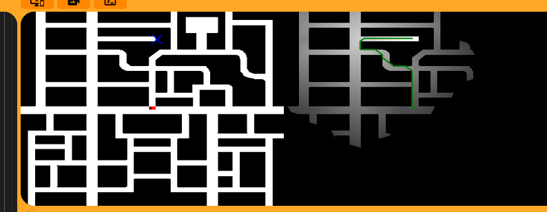
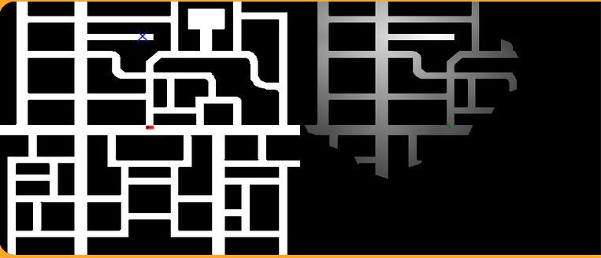
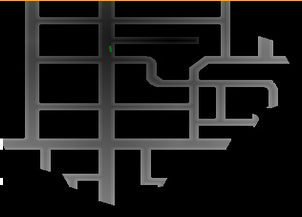

## Paso 1: la onda desde el destino

Al picar un destino, le asigno coste 0 y expando una onda con una cola de prioridad: los vecinos rectos suman 1 y los diagonales √2. Cuando la onda alcanza al coche, expando un pequeño margen más y paro, para no tener que calcular el mapa entero.



## Paso 2: seguir el gradiente

En cada iteración bajo 8 celdas por el campo desde la posición del coche, siempre hacia el vecino de menor coste, y el punto al que llego es el **objetivo local**. Al principio probé con una única celda, pero el movimiento no era suave y el coche iba en zigzag. Con 8 celdas la dirección es mucho más estable. El giro es proporcional al error de orientación hacia ese punto, y la velocidad lineal baja cuanto mayor es el error, para frenar en las curvas:

```python
V = max(5 - abs(error), 2)
HAL.setV(V)
HAL.setW(W * error)
```

El tramo verde es el camino desde el coche hasta el objetivo local (8 celdas):



## Paso 3: la superposición de los dos campos

Con solo la onda, el camino más corto pasa rozando los edificios y el coche se chocaba en las esquinas. Por eso el campo final es la **suma de dos subcampos**:

- **Propagación a destino:** la onda del paso 1, que atrae al coche hacia el destino.
- **Penalización por obstáculos:** depende solo de lo cerca que está cada celda de una pared. La calculo una vez al arrancar con `cv2.distanceTransform`, que da la distancia de cada celda al obstáculo más cercano.

```python
penalizacion = K / (distance + 1)
...
campo = coste + penalizacion
```

Al sumarlos, las celdas pegadas a las paredes quedan "más altas" y el gradiente lleva al coche por el centro de las calles. Al principio usaba K = 8, pero la penalización era tan pequeña frente a la onda que no servía de nada y el coche seguía pegado a la pared.

En la imagen se aprecia cómo la penalización aumenta cerca de los obstáculos, con tonos más claros:



## Problema: los mínimos locales

Al principio me aparecían **mínimos locales** con bastante frecuencia. El coche se quedaba dando vueltas en un cruce porque había caído en un "hoyo" del campo: una celda sin ninguna vecina más baja, aunque no fuera el destino.

Sumar los dos campos no garantiza que no haya mínimos locales, pero intenté reducirlos todo lo posible. Para ello hice que la penalización solo existiera cerca de las paredes, y no en el centro de la calle:

```python
penalizacion[distance > 4] = 0
```

Con un umbral de 3.5 la franja era demasiado fina y el coche volvía a chocar; con 4 casi no aparecen mínimos. Para los pocos que quedan, si el gradiente se atasca en la celda del coche, le pido consejo solo a la onda, que nunca tiene hoyos. Cerca del destino también ocurre: si el destino está pegado a una pared, la penalización desplaza el mínimo unos metros, y por eso doy el destino por alcanzado en un radio de 5 metros.

## Resultado

<video controls preload="metadata" playsinline style="width: 100%;" aria-label="Vídeo: Global Navigation">
  <source src="/Robotica-Movil-Practicas/vid/GlobalNavigation.mp4" type="video/mp4" />
  <a href="/Robotica-Movil-Practicas/vid/GlobalNavigation.mp4">Ver vídeo: Global Navigation</a>
</video>

## Conclusiones

En conclusión, he utilizado el plan como recurso. Para ello he generado dos campos, primero el de la onda y después el de la penalización, y los he unido mediante la superposición de campos.

El robot sigue el descenso del gradiente mirando 8 celdas por delante, para que el movimiento sea suave, ya que avanzando celda a celda hacía zigzag. Para seguirlo, la velocidad angular depende del error de orientación, y la velocidad lineal disminuye cuando ese error es grande.

Por último, he intentado reducir al máximo los mínimos locales, aunque no he conseguido eliminarlos por completo.